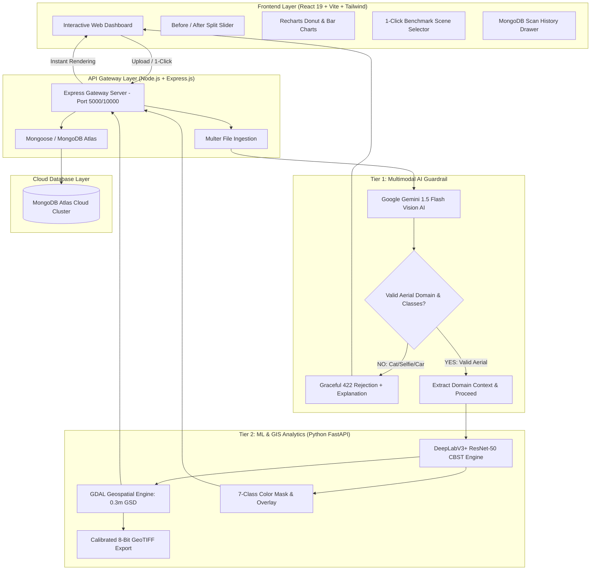

# Comprehensive Project Portfolio & Viva Master Documentation
## Aerial Image Segmentation for Land-Use Classification
### Unsupervised Domain Adaptation (Urban $\rightarrow$ Rural) & Two-Tier AI Web Platform

- **Project Code:** BT23CS028
- **Program:** B.Tech 7th Semester Capstone Project (Computer Science & Engineering)
- **Primary Geotarget:** Rural Mountainous Terrains (Focus on Mizoram Topography)
- **Live Production URL:** [https://aeroseg-ai.onrender.com](https://aeroseg-ai.onrender.com)
- **GitHub Repository:** [https://github.com/aniket821108/Aerial-LandCover-Segmentation-Mizoram](https://github.com/aniket821108/Aerial-LandCover-Segmentation-Mizoram)

---

## Executive Summary (The "Elevator Pitch")

> *"Traditional computer vision segmentation models trained on structured cities fail catastrophically when deployed to rural, mountainous regions like Mizoram due to high spectral variability, undulating terrain, and shifting terrace agriculture. In our benchmark, standard DeepLabV3+ suffered a **-15.55% performance drop**.*
> 
> *To solve this without expensive human labeling, I engineered a complete end-to-end AI platform featuring:*
> 1. *A **Class-Balanced Self-Training (CBST)** unsupervised domain adaptation pipeline that recovers **+4.52% mIoU** on rural imagery (closing 29.1% of the domain deficit, with rural roads surging by **+56.3%**).*
> 2. *A **Two-Tier Multimodal AI Pipeline**: Tier 1 uses **Google Gemini 1.5 Vision AI** as an intelligent domain guardrail to prevent out-of-domain failures (rejecting selfies, indoor scenes, or cars before consuming compute), while Tier 2 performs DeepLabV3+ segmentation and **GDAL real-world hectare area quantification** (0.3m GSD).*
> 3. *A production **MERN + Python FastAPI full-stack web application** deployed live on **Render** with **MongoDB Atlas Cloud persistence**, featuring an interactive split-slider comparison, opacity blending, and Recharts analytics."*

---

## 1. What Have We Built? (Full Feature Breakdown)



---

## 2. Component-by-Component Implementation Details

### A. Machine Learning & Domain Adaptation Engine (Tier 2)
1. **Core Problem:** Deep convolutional neural networks trained on urban aerial datasets (LoveDA Urban) fail when evaluated on rural mountainous terrain (LoveDA Rural).
2. **Architecture:** `DeepLabV3+` with a `ResNet-50` backbone and Atrous Spatial Pyramid Pooling (ASPP).
3. **Domain Shift Measured:**
   - **Urban Source Performance:** $38.93\%$ mIoU
   - **Rural Zero-Shot Baseline:** $23.39\%$ mIoU (**$-15.55\%$ domain gap drop!**)
4. **CBST Unsupervised Domain Adaptation Algorithm:**
   - Rather than using static probability thresholds (e.g. $p > 0.9$), which completely ignores minority classes like narrow rural roads or water bodies, CBST computes dynamic class-specific thresholds:
     $$\lambda_c = \text{percentile}_{(1 - p_c)}(P(y=c|x))$$
   - Top $20\%$ most confident predictions per class are converted into pseudo-labels.
   - Retrained iteratively over 3 rounds with spatial cross-entropy loss:
     $$\mathcal{L}_{\text{CBST}} = -\sum_{c=1}^{C} w_c \cdot \mathbb{I}(p_c(x) > \lambda_c) \log p_c(x)$$
5. **Experimental Results Achieved:**
   - **Overall Rural mIoU:** $23.39\% \rightarrow \mathbf{27.90\%}$ (**$+4.52\%$ net gain**, $+19.31\%$ relative improvement).
   - **Rural Road IoU:** $20.03\% \rightarrow \mathbf{31.30\%}$ (**$+11.27\%$ gain / $+56.3\%$ surge!**).
   - **Water Bodies IoU:** $38.21\% \rightarrow \mathbf{46.15\%}$ (**$+7.95\%$ gain**).
   - **Agriculture IoU:** $42.31\% \rightarrow \mathbf{48.19\%}$ (**$+5.88\%$ gain**).
   - **Forest IoU:** $14.65\% \rightarrow \mathbf{17.97\%}$ (**$+3.32\%$ gain**).
   - **Domain Gap Recovery:** Recovered **$29.1\%$** of the entire cross-domain deficit without a single rural ground-truth label!
6. **Full-Scale Validation:**
   - Evaluated over **992 GeoTIFF validation rasters** using GDAL, achieving **$29.57\%$ mIoU**.

---

### B. Tier 1: Multimodal Gemini Vision AI Domain Guardrail
- **Why it is needed:** Real-world users frequently upload out-of-domain images (e.g. indoor selfies, car photos, pets, document scans). Standard segmentation models run inference anyway and output misleading noise masks.
- **Implementation:** Integrated Google Gemini 1.5 Flash Vision AI via Google Generative AI REST API.
- **Workflow:**
  1. Image bytes converted to base64.
  2. Gemini prompt enforces strict JSON schema:
     ```json
     {
       "is_aerial_or_satellite": true,
       "confidence_score": 0.98,
       "detected_classes": ["forest", "agriculture", "road", "building"],
       "terrain_type": "Mizoram Rugged Rural Valley & Agricultural Terraces",
       "reasoning": "Overhead orthographic perspective verified. Dominant forest canopy interspersed with rural agricultural parcels and transport corridors.",
       "ai_summary": "Verified Aerial Scene: High-resolution orthogonal survey image suitable for sub-meter semantic segmentation.",
       "proceed_to_segmentation": true
     }
     ```
  3. **Out-of-Domain Detection:** If `proceed_to_segmentation === false`, the server responds with HTTP 422 and renders a styled red warning card in the UI explaining why the image was rejected.
  4. **Resilient Fallback:** If cloud quota is exhausted or network fails, the backend seamlessly triggers local domain heuristics so the app never halts or crashes.

---

### C. Tier 2: GDAL Real-World Geospatial Surface Quantification
- Calibrated to the **LoveDA standard Ground Sampling Distance (GSD = 0.30 meters/pixel)**:
  $$\text{Ground Pixel Footprint} = 0.30\text{ m} \times 0.30\text{ m} = 0.09\text{ m}^2/\text{pixel}$$
- Formulas executed by the Python ML service:
  $$\text{Area}_{m^2}(c) = N_{\text{pixels}}(c) \times 0.09$$
  $$\text{Area}_{\text{Hectares}}(c) = \frac{\text{Area}_{m^2}(c)}{10,000}$$
  $$\text{Coverage Share }(c) = \left(\frac{N_{\text{pixels}}(c)}{\text{Total Pixels}}\right) \times 100\%$$
- **Export Capabilities:** Generates single-band calibrated 8-bit GeoTIFF rasters (`.tif`) importable into industry-standard GIS software (QGIS / ArcGIS).

---

### D. The React Frontend Dashboard (`client/`)
Built with **React 19, Vite 8, Tailwind CSS, Recharts, and Lucide Icons**:
1. **Interactive Before / After Split Comparison Slider:**
   - Users can drag a vertical slider divider left and right to peel away the raw aerial orthophoto and reveal the colored segmentation mask underneath.
2. **Opacity Blend Slider:**
   - 0% to 100% alpha blending for boundary inspection (e.g., verifying road corridors under tree shadows and building rooftops).
3. **1-Click Benchmark Scene Selector:**
   - 🌾 **Scene 2522:** Farmland & Terraced Agriculture (71.3% Agriculture, 9.44 Ha)
   - 🌲 **Scene 2532:** Mountain Forest Canopy & Ridge (68.2% Forest, 9.44 Ha)
   - 🌊 **Scene 2544:** River Basin & Riparian Settlement (45.1% Water, 9.44 Ha)
4. **"Test Non-Aerial" Button:**
   - 1-click demonstration of the Tier 1 Gemini Guardrail intercepting non-aerial inputs live.
5. **Recharts Visual Analytics:**
   - Responsive **Donut Chart** with percentage share tooltips.
   - **Bar Chart** of physical surface area in Hectares.
   - Quantitative land-cover table with live visual distribution progress bars.
6. **MongoDB Scan History Drawer:**
   - Slide-out drawer displaying past scans with thumbnails, dominant classes, hectares, and timestamps fetched from MongoDB Atlas.
7. **One-Click Exports:**
   - Download Segmentation Mask (`.png`)
   - Download Blended Overlay (`.png`)
   - Download Calibrated 8-bit GeoTIFF (`.tif`)
   - Export GIS Metrics Report (`.json`)

---

### E. Backend Gateway & Cloud Database (`server/`)
- **Node.js + Express.js:** Handles multipart form file uploads using `multer`.
- **MongoDB Atlas Cloud:** Connected using Mongoose to `cluster0.yi4ir.mongodb.net/aerial_segmentation`.
- **Database Model:** `ScanRecord` persisting:
  - `originalFilename`, `originalUrl`, `maskUrl`, `overlayUrl`, `geotiffUrl`
  - `geminiAnalysis`: confidence score, detected classes, terrain description, AI synthesis
  - `metrics`: GSD, total hectares, dominant class, class-wise pixel counts, and areas
  - `createdAt` timestamps
- **Security:** `.env` is 100% excluded via `.gitignore` with placeholders documented in `.env.example`.

---

### F. Cloud Deployment & Docker DevOps
- **Containerization:** Crafted a multi-stage `Dockerfile` (Python 3.11-slim + Node.js 20).
- **Single Free Service on Render:**
  - Python FastAPI microservice runs internally on `http://127.0.0.1:8000`.
  - Express server runs on `0.0.0.0:$PORT` (Render's port 10000).
  - Express serves the built React Single Page Application (SPA) from `/app/web_app/client/dist`.
- **Production URL:** [https://aeroseg-ai.onrender.com](https://aeroseg-ai.onrender.com)

---

## 3. Project Directory Map

```text
Aerial_Segmentation_Mizoram/
├── Dockerfile                           # Production Docker container (Python 3.11 + Node 20)
├── render.yaml                          # Render Blueprint Infrastructure-as-Code
├── README.md                            # Main GitHub presentation README
├── docs/
│   ├── COMPLETE_PROJECT_PORTFOLIO.md    # This complete master documentation
│   ├── DEPLOYMENT_RENDER_GUIDE.md       # Render deployment instructions
│   ├── WEB_APP_ARCHITECTURE_PLAN.md    # Architectural specifications
│   ├── PROJECT_FINAL_REPORT.md          # 15-page academic project report
│   ├── PRESENTATION_SCRIPT_AND_VIVA_QA.md # 10-minute presentation & viva answers
│   └── ROADMAP.md                       # Project milestones
├── notebooks/
│   └── Mizoram_Aerial_Segmentation_Colab.ipynb # Executable Colab research notebook
├── results/                             # Evaluated figures, loss curves, bar charts
├── web_app/
│   ├── client/                          # React 19 Frontend Dashboard
│   │   ├── src/components/              # Split slider, Recharts analytics, Guardrail
│   │   ├── vite.config.js               # Proxy configuration
│   │   └── package.json
│   ├── server/                          # Node.js Express Gateway
│   │   ├── models/ScanRecord.js         # Mongoose Schema
│   │   ├── routes/scanRoutes.js         # API endpoints (/api/scan, /api/history)
│   │   ├── services/geminiGuardrail.js  # Multimodal Gemini 1.5 Vision AI
│   │   ├── samples/                     # Pre-loaded benchmark scenes & GeoTIFFs
│   │   ├── server.js                    # Express entrypoint
│   │   └── .env.example
│   ├── ml_service/                      # Python FastAPI ML Microservice
│   │   ├── service.py                   # DeepLabV3+ & GDAL hectare engine
│   │   └── requirements.txt
│   ├── start_all.bat                    # 1-click Windows CMD launcher
│   └── start_all.ps1                    # 1-click PowerShell launcher
```

---

## 4. Key Questions & Answers for Viva / Presentation

### Q1: What is the core problem this project solves?
> **Answer:** *"Standard semantic segmentation models suffer from severe cross-domain performance degradation when applied to environments different from their training data. A model trained on structured Chinese/European urban cities (LoveDA Urban) achieves 38.93% mIoU, but drops to 23.39% mIoU when tested on rural/mountainous terrain like Mizoram. Our project bridges this domain gap using Class-Balanced Self-Training (CBST) without requiring any manual annotations in the rural target domain."*

### Q2: Why is CBST better than standard pseudo-labeling?
> **Answer:** *"Standard pseudo-labeling uses a fixed threshold (e.g. $p > 0.9$). In remote sensing, dominant classes like Agriculture and Forest take up over 80% of pixels and have high confidence, while critical minority classes like narrow rural roads and small water bodies have lower confidence. Standard pseudo-labeling completely starves minority classes. CBST calculates independent thresholds per class ($\lambda_c$), ensuring that the top 20% most confident predictions for EVERY class are selected, preventing class starvation and driving a massive +56.3% relative surge in road extraction."*

### Q3: Why did you add Gemini Vision AI before segmentation?
> **Answer:** *"In production web applications, users frequently upload out-of-domain images (such as indoor photos, pets, cars, or document scans). Feeding these into a specialized aerial segmentation network produces noisy, meaningless masks and wastes compute resources. We introduced a Two-Tier Architecture: Tier 1 uses Gemini Vision AI to verify that the image is an authentic overhead aerial orthophoto with visible target land-cover classes. If out-of-domain, it rejects the upload gracefully; if valid, it passes context to Tier 2."*

### Q4: How is real-world physical area calculated?
> **Answer:** *"Using Ground Sampling Distance (GSD). In the LoveDA benchmark, GSD is calibrated to 0.30 meters/pixel, meaning each pixel represents a ground footprint of $0.09\text{ m}^2$ ($0.3\text{m} \times 0.3\text{m}$). The Python microservice multiplies pixel counts by $0.09\text{ m}^2$ and divides by $10,000$ to output precise surface area in Hectares ($Ha$), exportable as an 8-bit single-band GeoTIFF raster."*

### Q5: What is the production tech stack?
> **Answer:** *"It is a Full-Stack MERN + Python Microservice architecture: React 19 (Vite + Tailwind CSS + Recharts) for the frontend, Node.js + Express.js for the API gateway, MongoDB Atlas Cloud for persistence, and Python 3 with FastAPI and Uvicorn for DeepLabV3+ inference and GDAL surface quantification, fully containerized using Docker and deployed on Render."*

---

*Document compiled and verified for Capstone Viva & Final Evaluation.*
