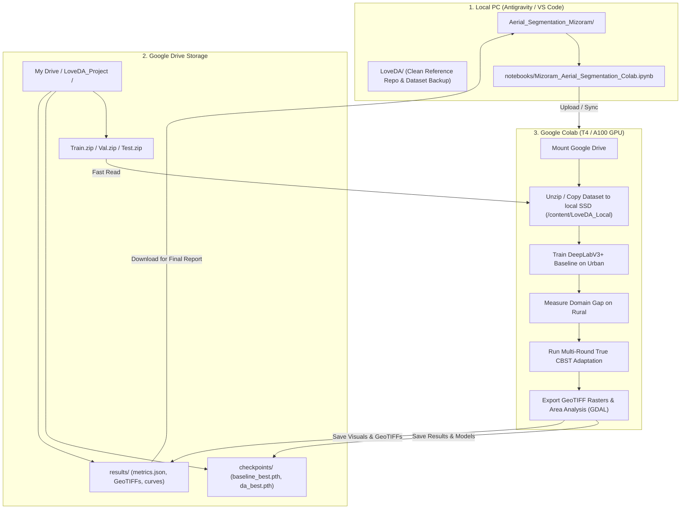

# Implementation Roadmap: Aerial Image Segmentation for Land Use Classification
**Project Code:** BT23CS028 | **Academic Level:** Undergraduate (Sem 7 Capstone)  
**Task:** Land Use / Land Cover (LULC) Semantic Segmentation (6 Classes)  
**Specialization:** Unsupervised Domain Adaptation (Urban -> Rural) for Mizoram Geography  
**Tech Stack:** PyTorch, GDAL, Segmentation-Models-PyTorch, Albumentations  

---

## 1. Project Architecture & End-to-End Workflow

This project follows a dual-environment workflow: code development and architectural refinement are done locally with Antigravity, while heavy GPU training runs in Google Colab with data stored on Google Drive.



---

> [!IMPORTANT]
> ### Critical Action Needed: Check `Train` Folder in Google Drive
> In your Google Drive folder (`My Drive > LoveDA_Project`), the current view shows **`Test`** and **`Val`**.
> * **For training to proceed in Colab, the `Train` dataset (Urban and Rural) must also be accessible.**
> * **Best Practice for Fast Upload:** Do not upload 2,500 loose PNGs one by one (Google Drive throttles individual small files). Instead, compress `LoveDA\Train` locally into a single `Train.zip` (~3.5 GB) and upload that file to `LoveDA_Project/`. In Colab, unzipping takes under 30 seconds!

---

## 2. Directory Structure

We keep the cloned `LoveDA` repository intact as an unaltered reference and place all project work in `Aerial_Segmentation_Mizoram`:

```text
Cv_project/
├── Aerial_Segmentation_Mizoram/          <-- YOUR ACTIVE PROJECT DIRECTORY
│   ├── notebooks/
│   │   └── Mizoram_Aerial_Segmentation_Colab.ipynb  <-- Clean, verified, executable notebook
│   ├── docs/
│   │   ├── ROADMAP.md                    <-- This implementation plan
│   │   └── PROJECT_REPORT_OUTLINE.md     <-- Semester evaluation report structure
│   └── results/                          <-- Downloaded figures, metrics, and GeoTIFFs
│       ├── checkpoints/
│       ├── figures/
│       └── gdal_outputs/
│
├── LoveDA/                               <-- REFERENCE ONLY (Do not modify)
│   ├── Train/ (Local dataset backup)
│   ├── Val/
│   ├── Test/
│   ├── Semantic_Segmentation/
│   └── Unsupervised_Domian_Adaptation/
└── LoveDA_Aerial_Segmentation.ipynb       <-- Initial draft (archived for reference)
```

---

## 3. Five-Phase Implementation Roadmap

### Phase 1: Clean Data Pipeline & Label Resolution
* **Problem in draft:** Background (1), no-data (0), and pseudo-label ignore values collide at index 0.
* **Fix:**
  * Configure `IGNORE_INDEX = 255`.
  * Map raw LoveDA mask values:
    * `0` (no-data / invalid) -> 255
    * `1` (background) -> 0
    * `2` (building) -> 1
    * `3` (road) -> 2
    * `4` (water) -> 3
    * `5` (barren) -> 4
    * `6` (forest) -> 5
    * `7` (agriculture) -> 6
  * This yields exactly **6 active land-cover categories** (Building, Road, Water, Barren, Forest, Agriculture) + 1 background class.
* **Fast I/O loader:** Add automated `.zip` detection in Colab to unpack directly to `/content/LoveDA_Local/` in RAM/local NVMe.

---

### Phase 2: GDAL Geospatial Module (Syllabus Requirement)
The problem statement explicitly requires **GDAL** alongside PyTorch. We implement three core geospatial capabilities:
1. **Raster Inspector:** Reads raster driver, bounding dimensions, band metadata, and Ground Sampling Distance (GSD = 0.3 m per pixel).
2. **GeoTIFF Raster Exporter:** Writes prediction probability arrays into standardized 8-bit GeoTIFF rasters (`.tif`) with an embedded GDAL Color Table (`GDALColorTable`), enabling direct drag-and-drop viewing in QGIS and ArcGIS.
3. **Geospatial Land-Use Quantification:**
   Computes exact real-world coverage for each class in hectares (critical for forestry and agricultural monitoring in hilly geography).

---

### Phase 3: Urban Source Baseline & Domain Shift Quantification
* **Model:** DeepLabV3+ with ResNet-50 encoder (ImageNet pretrained) via `segmentation_models_pytorch`.
* **Supervised Training on Urban:**
  * Loss: Cross-Entropy Loss with `ignore_index=255`.
  * Optimizer: AdamW ($lr = 6\times 10^{-4}$), Cosine Annealing scheduler.
  * Checkpoint persistence directly to Google Drive `/checkpoints/baseline_best.pth`.
* **Zero-Shot Evaluation on Rural (The Baseline Domain Gap):**
  * Evaluate the Urban-trained model directly on Rural validation images.
  * Quantify the **Domain Gap**: $\text{mIoU}_{\text{Urban}} - \text{mIoU}_{\text{Rural}}$.
  * Document which classes drop most severely (typically Roads, Buildings, and Barren/Agriculture confusion).

---

### Phase 4: True Class-Balanced Self-Training (CBST) Domain Adaptation
* **Problem in draft:** The existing code used a flat confidence threshold of 0.90, which causes high-confidence dominant classes (Forest, Water) to monopolize pseudo-labels while Buildings and Roads receive zero pseudo-labels.
* **True CBST Implementation:**
  1. For each target class $c$, calculate the class-specific threshold $\lambda_c$ using top-$p\%$ quantile filtering.
  2. Assign pseudo-labels only to pixels meeting their class-specific threshold; all other pixels are set to `255` (ignored).
  3. **Joint Adaptation Objective:** $\mathcal{L}_{\text{total}} = \mathcal{L}_{\text{source}}(\text{Urban}) + \alpha \cdot \mathcal{L}_{\text{target}}(\text{Rural pseudo-labels})$.
  4. Run 3 iterative rounds of pseudo-label generation and fine-tuning.

---

### Phase 5: Mizoram Case Study, Visualizations & Deliverables
* **Contextual Analysis for Mizoram Geography:**
  * Forest canopy density and seasonal canopy changes.
  * Shifting cultivation (*Jhum*) creating irregular agricultural patches that confuse standard urban models.
  * Steep terrain causing shadows and non-orthogonal road geometries.
* **Deliverable Visuals:**
  * 4-Column visual progression: `[Input Aerial Scene | Ground Truth | Baseline Model | CBST Adapted Model]`.
  * Class-by-class IoU improvement bar charts (Baseline vs. CBST).
  * Land-use area change breakdown in hectares.
  * `final_metrics.json` stored in Drive and local `results/`.

